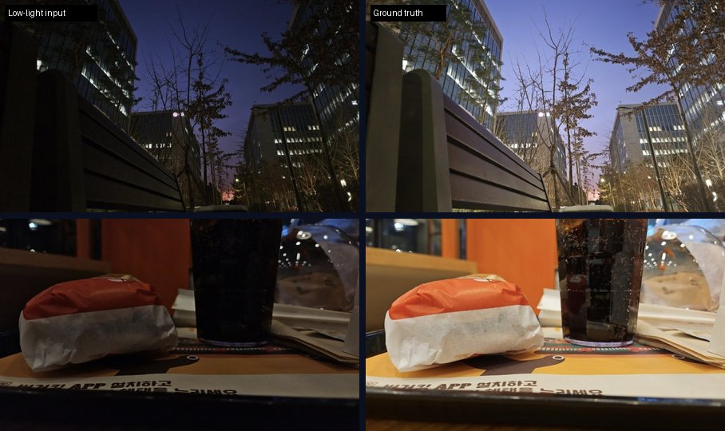
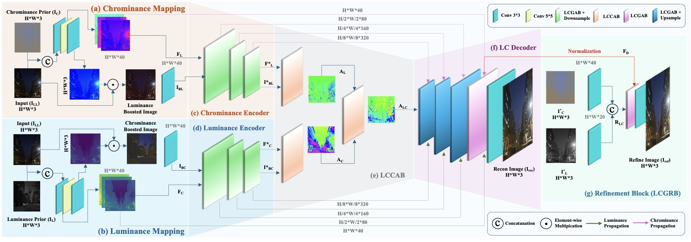
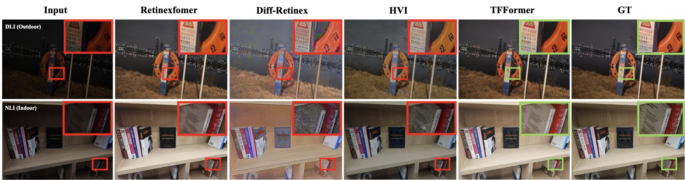
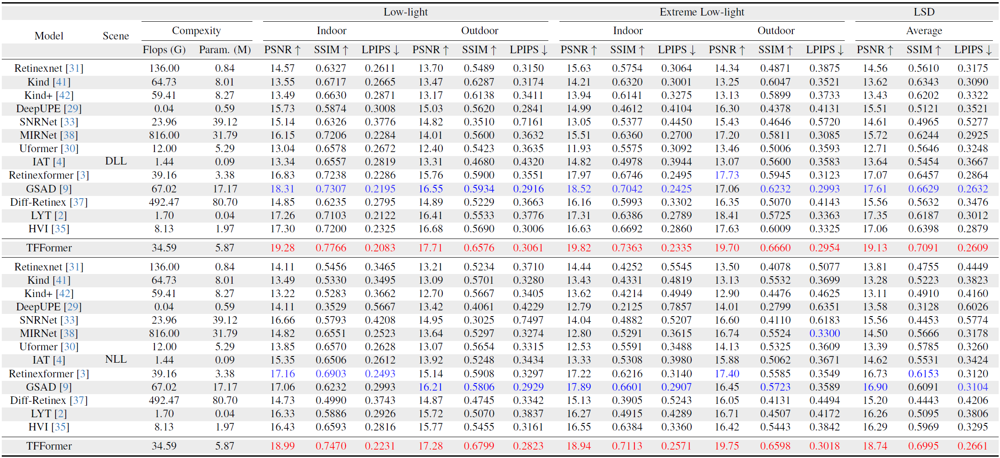

<div align="center">

# LSD: Low-light Smartphone Dataset

### Illuminating Darkness: Learning to Enhance Low-light Images In-the-Wild
**WACV 2026**

[**Website**](https://lsd-website.apuism.workers.dev) · [**Paper**](https://arxiv.org/abs/2503.06898) · [**Dataset**](https://huggingface.co/datasets/ARM4588/Lowlight-Smartphone-Dataset) · [**Results**](#results) · [**Talk**](https://www.youtube.com/watch?v=3GQWxt8QlwE) · [**Poster**](assets/poster_wacv.pdf) · [**Support LSD**](#support-lsd)

[](https://lsd-website.apuism.workers.dev)
[](https://arxiv.org/abs/2503.06898)
[](https://huggingface.co/datasets/ARM4588/Lowlight-Smartphone-Dataset)
[](https://creativecommons.org/licenses/by-nc/4.0/)
[](#license)
[](https://github.com/sponsors/sharif-apu)



</div>

**LSD** is the largest real-world paired dataset for single-shot low-light image enhancement: **6,425 aligned low/normal-light pairs** captured in the wild on **15 smartphone sensors**, from **0.1 to 200 lux**, plus **LSD-U**, **2,117 unpaired images** from unseen devices for testing generalization. This repository also contains **TFFormer**, our luminance–chrominance decoupled enhancement model.

## News

- **[Nov 2026]** 🚀 **LSD benchmark and leaderboard launched.** Download the test inputs ([DLL](https://drive.google.com/file/d/1juir8fqQZQpbsDPlmyc_PKvUKvvVCwc3/view?usp=sharing) · [NLL](https://drive.google.com/file/d/1Oiacna8WCq8Qa1deKRcY84YLFBcVD7RW/view?usp=sharing), 25 scenes per track), submit your results on the [website](https://lsd-website.apuism.workers.dev/#submit), and get scored on hidden ground truth. See the [leaderboard](https://lsd-website.apuism.workers.dev/#leaderboard).
- **[Nov 2026]** 🌐 **New [LSD website](https://lsd-website.apuism.workers.dev)**: samples, LSD-U, paper results, the benchmark and news in one place.
- **[Coming Soon]** We are organizing the **NTIRE 2027** low-light enhancement challenge on LSD at CVPR 2027. Details coming soon.
- **[Nov 2026]** TFFormer checkpoint released and the LSD-U unpaired test set fixed.
- **[Jan 2026]** LSD was the official dataset of the **NTIRE 2026 Single-Shot Low-Light Enhancement Challenge** at CVPR 2026: [Track 1 (in-the-wild)](https://www.codabench.org/competitions/11864/), [Track 2 (joint denoising)](https://www.codabench.org/competitions/12994/), [NTIRE 2026](https://cvlai.net/ntire/2026/).
- **[Jan 2026]** Dataset mirrored on [Hugging Face](https://huggingface.co/datasets/ARM4588/Lowlight-Smartphone-Dataset).

## The dataset

| | LSD (paired) | LSD-U (unpaired) |
|---|---|---|
| Images | 6,425 pairs (6,025 train · 400 test) | 2,117 |
| Sources | 15 smartphone sensors | Video frames 1,217 · DSLR 300 · Android 300 · iPhone 250 · social media 50 |
| Illuminance | 0.1–200 lux, ISO 50–3200 | mixed |
| Resolution | 4K+ full scenes, ~180K training patches | mixed |
| Use | training and full-reference benchmarking | generalization and perceptual evaluation |

Paired data comes in two variants:

- **DLL** (denoised low-light, 3,175 pairs): for low-light enhancement.
- **NLL** (noisy low-light, 3,250 pairs): for joint denoising and enhancement.

**Compared with existing paired datasets**

| Dataset | Sensors | Resolution | Full scene | Pairs |
|---|:-:|:-:|:-:|--:|
| LOL-V1 | 1 | 400×600 | ✗ | 500 |
| LOL-V2 | 1 | 400×600 | ✗ | 789 |
| LSRW | 2 | 960×720 | ✗ | 5,650 |
| NCLLIE | 1 | 4K+ | ✓ | 225 |
| **LSD** | **15** | **4K+** | ✓ | **6,425** |

### Download

| Source | Contents |
|---|---|
| [Hugging Face](https://huggingface.co/datasets/ARM4588/Lowlight-Smartphone-Dataset) | Training patches: `patch_DLL_{input,gt}Patch.tar.gz`, `patch_NLL_{input,gt}Patch.tar.gz` (166 GB total) |
| [Google Drive](https://drive.google.com/drive/folders/1QPT6vbRlA-47N0xNElmVYYR6hx9hGZiw?usp=sharing) | Full scenes, 400-pair test set, LSD-U |

```
LSD/
├── training/
│   ├── full_scenes/
│   └── patches/
│       ├── inputPatchDLL/   gtPatchDLL/
│       └── inputPatchNLL/   gtPatchNLL/
└── testing/
```

## Benchmark

Submit your enhanced results and get scored on **hidden ground truth** with the same evaluation script for everyone. Two tracks, 25 test scenes each:

| Track | Task | Test inputs |
|---|---|---|
| **DLL** | low-light enhancement | [Download](https://drive.google.com/file/d/1juir8fqQZQpbsDPlmyc_PKvUKvvVCwc3/view?usp=sharing) (`DLL_001.jpg` … `DLL_025.jpg`, 135 MB) |
| **NLL** | joint denoising and enhancement | [Download](https://drive.google.com/file/d/1Oiacna8WCq8Qa1deKRcY84YLFBcVD7RW/view?usp=sharing) (`NLL_001.jpg` … `NLL_025.jpg`, 217 MB) |

1. Enhance every input of a track at full resolution.
2. Save each result as PNG with the same name (`DLL_001.png` …) and zip them.
3. Register and upload on the [Submit page](https://lsd-website.apuism.workers.dev/#submit). Scores: PSNR, SSIM and LPIPS.

Approved entries appear on the [leaderboard](https://lsd-website.apuism.workers.dev/#leaderboard). For the results reported in the paper, see [Results](#results).

## TFFormer

**TFFormer** is a luminance–chrominance (LC) decoupled Transformer for low-light enhancement. It splits the input into luminance and chrominance, encodes each with attention, fuses them with LC cross-attention, decodes an intermediate image, and refines it with an LC-guided reconstruction block (LCGRB). Keeping structure (luminance) and color (chrominance) separate reduces noise while avoiding over-brightening and color shifts.

<p align="center"></p>

### Installation

Tested with Python 3.10, PyTorch 2.5 and CUDA 12 on Linux. The pinned `nvidia-*` and `triton` packages are Linux/CUDA only.

```bash
git clone https://github.com/sharif-apu/LSD-TFFormer.git
cd LSD-TFFormer
python -m venv .venv && source .venv/bin/activate
pip install --upgrade pip
pip install -r requirement.txt
```

### Configuration

Set your paths in `mainModule/config.json`:

```json
"gtPath": "./lsd/gtPatch/",
"targetPath": "./lsd/inputPatch/",
"testImagePath": "./lsd_test/",
"checkpointPath": "./modelLog/LowLightEnhancement/checkpoint_TFFormer/"
```

`testImagePath` should contain the `gtPatch` and `inputPatch` folders of the test set.

### Pretrained checkpoint

Download from [Google Drive](https://drive.google.com/drive/folders/1Y9wOSCVOTao2QoyyKu2lXw83bXVzr3Vk?usp=sharing) and point `checkpointPath` to it.

### Training

```bash
python main.py -ts   # train from scratch
python main.py -tr   # resume or fine-tune from checkpointPath
```

Checkpoints and enhanced images are written to `modelLog/`.

> **Fine-tuning note:** the number of training steps/epochs in the config must exceed those stored in the checkpoint, otherwise training stops immediately.

### Results

<p align="center"></p>

TFFormer recovers cleaner text and texture and more faithful color than recent methods, on both the DLL (enhancement) and NLL (joint denoising) tracks.

<p align="center"></p>

Quantitative benchmark on the LSD dataset, as reported in the paper. The best and second-best results are highlighted in red and blue, respectively.

## Support LSD

LSD is **entirely self-funded**. Over two years of data collection, storage, hosting and the benchmark server have all been paid by the authors themselves. The data, code and benchmark stay free for research. If LSD is useful to you or your company, please help keep it running:

- **Sponsor on GitHub.** Monthly or one-time, any amount: **[github.com/sponsors/sharif-apu](https://github.com/sponsors/sharif-apu)**.
- **Commercial license.** The dataset is CC BY-NC 4.0. To use LSD or TFFormer in a product, email [apuism@gmail.com](mailto:apuism@gmail.com?subject=LSD%20commercial%20license).
- **Sponsorship.** Fund benchmark compute, NTIRE 2027 prizes or the next LSD release. Sponsors are credited on the [website](https://lsd-website.apuism.workers.dev/#support) and have no influence on scoring or rankings. Email [apuism@gmail.com](mailto:apuism@gmail.com?subject=LSD%20sponsorship).
- **Spread the word.** Cite the paper, ⭐ star this repository, and [submit your method to the benchmark](https://lsd-website.apuism.workers.dev/#submit).

## Citation

```bibtex
@inproceedings{sharif2026illuminating,
  title={Illuminating Darkness: Learning to Enhance Low-light Images In-the-Wild},
  author={Sharif, SMA and Rehman, Abdur and Abidin, Zain Ul and Dharejo, Fayaz Ali and Timofte, Radu and Naqvi, Rizwan Ali},
  booktitle={Proceedings of the IEEE/CVF Winter Conference on Applications of Computer Vision (WACV)},
  pages={2263--2272},
  year={2026}
}
```

## License

- **Code:** MIT.
- **Dataset (LSD and LSD-U):** [CC BY-NC 4.0](https://creativecommons.org/licenses/by-nc/4.0/). Free for non-commercial research with attribution. For commercial use, see [Support LSD](#support-lsd).

## About

LSD took over two years to collect and is self-funded research. We release the data and code openly because we believe research should be accessible to everyone. If LSD or TFFormer helps your work, please cite the paper and consider [supporting LSD](#support-lsd).

**Authors:** S M A Sharif¹, Abdur Rehman¹, Zain Ul Abidin², Fayaz Ali Dharejo³, Radu Timofte³, Rizwan Ali Naqvi²
¹Opt-AI Inc. · ²Sejong University · ³University of Würzburg

**Contact:** apuism@gmail.com · abdurehman458@gmail.com

**Acknowledgment:** This code builds on [BJDD](https://github.com/sharif-apu/BJDD_CVPR21) and [Retinexformer](https://github.com/caiyuanhao1998/Retinexformer).
